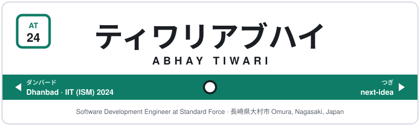
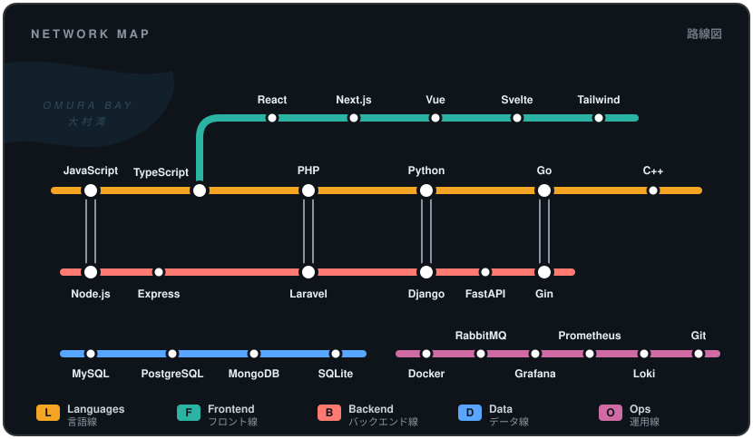

  
   
  Click the sign to hear the departure chime · 駅名標をクリックすると発車メロディが流れます

  
  
  
  
  
  

  

  
   
  
    <a href="https://github.com/i-m-abbhay/pounce">pounce</a> ·
    <a href="https://github.com/i-m-abbhay/direct4b-mcp">direct4b-mcp</a> ·
    <a href="https://github.com/i-m-abbhay/nihongo">nihongo</a> ·
    <a href="https://github.com/i-m-abbhay/karimen-honmen">karimen-honmen</a> ·
    <a href="https://github.com/i-m-abbhay/Eat-That-Frog-Task-Tracker">Eat-That-Frog</a>
  

  

- [We Were About to Pay ¥50,000 More a Month for a Bigger Disk.](https://medium.com/@abhay.tiwari.er/we-were-about-to-pay-50-000-more-a-month-for-a-bigger-disk-03af49cb5698)
- [Object Storage for VPS Developers](https://medium.com/@abhay.tiwari.er/object-storage-for-vps-developers-70de08e2dd41)
- [How to make your own Protocol (like HTTP) in 10 minutes](https://medium.com/@abhay.tiwari.er/how-to-make-your-own-protocol-like-http-in-10-minutes-3e61de91ad2f)
- [All About HTTP Headers](https://medium.com/@abhay.tiwari.er/all-about-http-headers-16285e484951)
- [AI is making me faster for sure but I feel empty and sad afterwards.](https://medium.com/@abhay.tiwari.er/ai-is-making-me-faster-for-sure-but-i-feel-empty-and-sad-afterwards-94ee2f75ff27)
- [More on Medium](https://medium.com/@abhay.tiwari.er): Go concurrency (goroutines, channels, mutexes), cleaning up a hacked site, tuning MySQL on a 2018 Laravel ERP.

  

  Thank you for riding. またのご乗車をお待ちしております。
    
  

